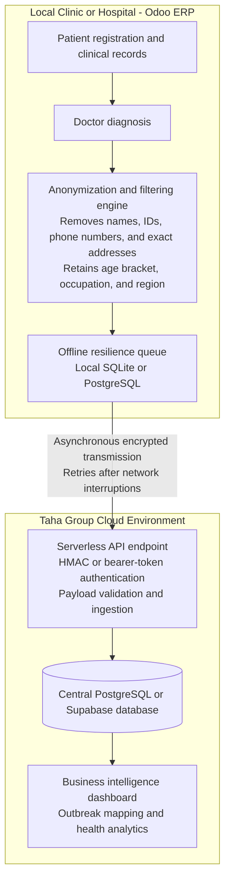

# Taha Group - Enterprise Epidemiological Data Sync System (TEEDSS)
**Master Project Blueprint & Architectural Specification**

This repository now contains a working implementation of that blueprint:

| Piece | What it is | URL after `docker compose up` |
|---|---|---|
| Clinic ERP | Local patient + diagnosis app. PII never leaves the clinic. | http://127.0.0.1:8001 |
| Taha Group central server | Encrypted ingest API + PostgreSQL | http://127.0.0.1:8000/docs |
| Command dashboard | Outbreak, region, age, and occupation analytics | http://127.0.0.1:8000 |
| Odoo addon | Production module to drop into clinic Odoo | `odoo_addon/taha_epidemiology_sync` |

---

## 0. How to run the Taha Group server (where clinic data goes)

The central server is the Taha Group cloud. Clinics do **not** write to it directly from the doctor screen. They anonymize locally, queue the payload, then `POST` it to:

`POST /api/v1/epidemiology/sync`

### Fastest path (Docker)

1. Copy `.env.example` to `.env` and replace the token and HMAC secret before any real deployment.
2. From this folder run:

```bash
docker compose up --build
```

3. Open:
   - Clinic (doctors): http://127.0.0.1:8001
   - Taha Group dashboard: http://127.0.0.1:8000
4. In the clinic app, register a patient (name, phone, national ID stay here), log a diagnosis, and watch the anonymized event appear on the dashboard.

PostgreSQL is the system of record for Taha Group. The clinic keeps its own SQLite file for patients and the offline retry queue.

### What you must configure on a real Taha Group server

| Setting | Purpose |
|---|---|
| `DATABASE_URL` | PostgreSQL connection, e.g. `postgresql://taha:SECRET@db:5432/taha_epi` |
| `TAHA_API_TOKEN` | Shared bearer token given to each facility |
| `TAHA_HMAC_SECRET` | Shared HMAC key. Every request body is signed with `X-Taha-Signature` |
| `SEED_DEMO` | Set `false` in production so demo cases are not inserted |

Put the server on HTTPS (TLS 1.3) behind nginx, Caddy, or a cloud load balancer. The app currently authenticates ingest with **Bearer token + HMAC-SHA256 of the raw JSON body**. Rotate those secrets per environment.

### Payload the server accepts (whitelist only)

```json
{
  "event_id": "9f3c0a8e-6b1d-4d2a-9c11-2f0e8a77c101",
  "facility_code": "CLN-KRT-001",
  "diagnosis_code": "B50",
  "diagnosis_name": "Malaria",
  "age_bracket": "30-39",
  "occupation": "Teacher",
  "city": "Khartoum",
  "district": "Khartoum",
  "region": "Khartoum",
  "gender": "female",
  "diagnosed_at": "2026-10-16T12:04:00+00:00"
}
```

Anything named like `name`, `phone`, `email`, `national_id`, `street`, `patient_id`, or `billing` is rejected.

### Hosting options for the same API

The FastAPI app in `central/` is the Taha Group server. You can run that same code:

1. **On a Taha Group VM** with Docker Compose (this repo).
2. **On a cloud VM** (AWS, Azure, DigitalOcean): install Docker, set secrets, map port 443.
3. **Serverless-style**: wrap `central/app` in a container on Cloud Run, App Runner, or Azure Container Apps, and attach managed PostgreSQL (RDS, Cloud SQL, or Supabase). Point each clinic's `CENTRAL_API_URL` at that HTTPS URL.

Clinics only need:

```
CENTRAL_API_URL=https://epi.tahagroup.example
TAHA_API_TOKEN=...
TAHA_HMAC_SECRET=...
FACILITY_CODE=CLN-KRT-001
```

### Odoo clinics

Copy `odoo_addon/taha_epidemiology_sync` into the Odoo addons path, update apps list, install **Taha Epidemiological Data Sync**, then set the API URL, token, HMAC secret, and facility code under Settings. Diagnoses are queued locally and flushed by a 5-minute cron if the network is down.

### Local run without Docker

```bash
python3 -m venv .venv
source .venv/bin/activate
pip install -r central/requirements.txt -r clinic/requirements.txt
mkdir -p data
DATABASE_URL=sqlite:///./data/central.db SEED_DEMO=true uvicorn app.main:app --app-dir central --port 8000
# other terminal
DATABASE_URL=sqlite:///./data/clinic.db CENTRAL_API_URL=http://127.0.0.1:8000 uvicorn app.main:app --app-dir clinic --port 8001
```

---

## 1. Document Control & Metadata
* **Project Code:** TEEDSS-ERP-SYNC
* **Initiative:** Public Health Intelligence & Macro-Level Resource Optimization
* **Sponsor:** Taha Group
* **Technical Lead / Architect:** SDT Creative
* **Document Status:** APPROVED - ARCHITECTURAL BLUEPRINT
* **Target Platforms:** Odoo ERP (Local Clinics/Hospitals) + Cloud Analytics Infrastructure

---

## 2. Executive Summary & Strategic Objective
The **Taha Group Epidemiological Data Sync System (TEEDSS)** is a specialized, privacy-first integration framework designed to bridge distributed clinic/hospital ERP instances with a centralized intelligence pipeline. 

As healthcare facilities utilize standard ERP workflows for daily operations (patient registration, clinical notes, doctor scheduling, and billing)[cite: 1], a wealth of public health indicators remains trapped locally. TEEDSS establishes a secure, automated, and strictly anonymized data-harvesting mechanism. It abstracts macro-level disease prevalence and demographic trends in real-time, enabling Taha Group leadership to execute data-driven resource allocation, preemptive supply chain routing, and targeted occupational health campaigns without compromising patient confidentiality[cite: 1].

---

## 3. Core System Architecture

The architecture is divided into three decoupled tiers to ensure high availability, zero latency impact on medical staff, and strict compliance with data privacy standards:



---

## 4. Data Governance & Privacy Protocol (Strict Guidelines)

Patient privacy is architecturally enforced at the model level via a deterministic filtering layer. No transmission occurs unless data passes the strict inclusion/exclusion whitelist.

### 4.1 Permitted Data Payload (Transmitted)
* **Disease / Diagnosis:** Standardized medical or ICD-10 diagnostic codes[cite: 1].
* **Demographics:** Age or generalized age bracket (e.g., `30-40`)[cite: 1].
* **Occupational Context:** Patient profession or type of work (for occupational health correlation)[cite: 1].
* **General Geographic Location:** City, District, or Region identifier (No street-level data)[cite: 1].
* **Temporal Marker:** Standardized UTC timestamp of diagnosis[cite: 1].

### 4.2 Prohibited Data Payload (Blocked & Sanitized)
* **Identifiers:** First name, last name, middle names, or system aliases[cite: 1].
* **Communication Channels:** Phone numbers, mobile numbers, email addresses[cite: 1].
* **Precise Spatial Data:** Street names, house/apartment numbers, exact GPS coordinates[cite: 1].
* **Government/System IDs:** National ID numbers, passport numbers, internal medical record numbers[cite: 1].
* **Financial Data:** Billing information, insurance policy IDs, payment methods[cite: 1].

---

## 5. Technical Specification & Implementation Modules

### Tier 1: Local Odoo ERP Module (`taha_epidemiology_sync`)
* **Framework Compatibility:** Odoo 16, 17, 18 (Python & XML).
* **Core Components:**
  * `__manifest__.py`: Module metadata, security permissions, and dependency configurations.
  * `models/clinical_record.py`: Python inheritance (`models.Model`) overriding `create` and `write` methods on medical/clinical logs to trigger background extraction hooks.
  * `models/sync_queue.py`: Local database queue ensuring that if internet connectivity fails, payloads are safely persisted locally and flushed asynchronously via scheduled cron jobs upon network restoration[cite: 1].
  * `views/res_config_settings.xml`: Administrative configuration interface allowing facility managers to input the Central API Gateway URL and Secret Access Tokens.

### Tier 2: Cloud Ingestion API Gateway
* **Stack:** Node.js (Express) or Python (FastAPI).
* **Endpoint:** Secure `POST /api/v1/epidemiology/sync`.
* **Security:** Request header validation using pre-shared secret keys, HTTPS/TLS 1.3 encryption in transit.
* **Database Target:** Scalable relational cloud database (e.g., Supabase / PostgreSQL).

### Tier 3: Command & Control Dashboard
* **Tooling:** Retool / Appsmith / Metabase.
* **Capabilities:** Real-time spatial visualization of disease prevalence, cross-referencing regional spikes with occupational cohorts to assist Taha Group management in medical resource deployment[cite: 1].

---

## 6. Implementation Roadmap & Development Phases
* **Phase 1:** Repository Initialization & Architectural Documentation — done
* **Phase 2:** Development of Odoo Local Module Backend & Anonymization Engine — done (`odoo_addon/`, `clinic/`)
* **Phase 3:** Construction of Cloud Ingestion API & Secure Database Schema — done (`central/`)
* **Phase 4:** Integration Testing of Offline Queue & Asynchronous Synchronization — clinic SQLite queue + background retry
* **Phase 5:** Deployment, Pilot Testing at Selected Facilities, and Dashboard Configuration — run `docker compose up --build` and point production `CENTRAL_API_URL` at the Taha Group host

