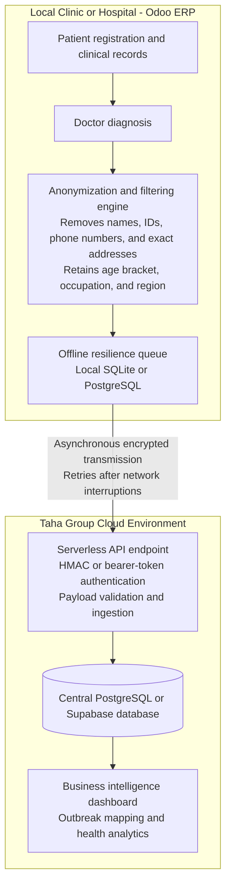

# Taha Group - Enterprise Epidemiological Data Sync System (TEEDSS)
**Master Project Blueprint & Architectural Specification**

---

## 1. Document Control & Metadata
* **Project Code:** TEEDSS-ERP-SYNC
* **Initiative:** Public Health Intelligence & Macro-Level Resource Optimization
* **Sponsor:** Taha Group
* **Technical Lead / Architect:** SDT Creative
* **Document Status:** APPROVED - ARCHITECTURAL BLUEPRINT
* **Target Platforms:** Odoo ERP (Local Clinics/Hospitals) + Cloud Analytics Infrastructure

---

## 2. Executive Summary & Strategic Objective
The **Taha Group Epidemiological Data Sync System (TEEDSS)** is a specialized, privacy-first integration framework designed to bridge distributed clinic/hospital ERP instances with a centralized intelligence pipeline. 

As healthcare facilities utilize standard ERP workflows for daily operations (patient registration, clinical notes, doctor scheduling, and billing)[cite: 1], a wealth of public health indicators remains trapped locally. TEEDSS establishes a secure, automated, and strictly anonymized data-harvesting mechanism. It abstracts macro-level disease prevalence and demographic trends in real-time, enabling Taha Group leadership to execute data-driven resource allocation, preemptive supply chain routing, and targeted occupational health campaigns without compromising patient confidentiality[cite: 1].

---

## 3. Core System Architecture

The architecture is divided into three decoupled tiers to ensure high availability, zero latency impact on medical staff, and strict compliance with data privacy standards:

---

## 4. Data Governance & Privacy Protocol (Strict Guidelines)

Patient privacy is architecturally enforced at the model level via a deterministic filtering layer. No transmission occurs unless data passes the strict inclusion/exclusion whitelist.

### 4.1 Permitted Data Payload (Transmitted)
* **Disease / Diagnosis:** Standardized medical or ICD-10 diagnostic codes[cite: 1].
* **Demographics:** Age or generalized age bracket (e.g., `30-40`)[cite: 1].
* **Occupational Context:** Patient profession or type of work (for occupational health correlation)[cite: 1].
* **General Geographic Location:** City, District, or Region identifier (No street-level data)[cite: 1].
* **Temporal Marker:** Standardized UTC timestamp of diagnosis[cite: 1].

### 4.2 Prohibited Data Payload (Blocked & Sanitized)
* **Identifiers:** First name, last name, middle names, or system aliases[cite: 1].
* **Communication Channels:** Phone numbers, mobile numbers, email addresses[cite: 1].
* **Precise Spatial Data:** Street names, house/apartment numbers, exact GPS coordinates[cite: 1].
* **Government/System IDs:** National ID numbers, passport numbers, internal medical record numbers[cite: 1].
* **Financial Data:** Billing information, insurance policy IDs, payment methods[cite: 1].

---

## 5. Technical Specification & Implementation Modules

### Tier 1: Local Odoo ERP Module (`taha_epidemiology_sync`)
* **Framework Compatibility:** Odoo 16, 17, 18 (Python & XML).
* **Core Components:**
  * `__manifest__.py`: Module metadata, security permissions, and dependency configurations.
  * `models/clinical_record.py`: Python inheritance (`models.Model`) overriding `create` and `write` methods on medical/clinical logs to trigger background extraction hooks.
  * `models/sync_queue.py`: Local database queue ensuring that if internet connectivity fails, payloads are safely persisted locally and flushed asynchronously via scheduled cron jobs upon network restoration[cite: 1].
  * `views/res_config_settings.xml`: Administrative configuration interface allowing facility managers to input the Central API Gateway URL and Secret Access Tokens.

### Tier 2: Cloud Ingestion API Gateway
* **Stack:** Node.js (Express) or Python (FastAPI).
* **Endpoint:** Secure `POST /api/v1/epidemiology/sync`.
* **Security:** Request header validation using pre-shared secret keys, HTTPS/TLS 1.3 encryption in transit.
* **Database Target:** Scalable relational cloud database (e.g., Supabase / PostgreSQL).

### Tier 3: Command & Control Dashboard
* **Tooling:** Retool / Appsmith / Metabase.
* **Capabilities:** Real-time spatial visualization of disease prevalence, cross-referencing regional spikes with occupational cohorts to assist Taha Group management in medical resource deployment[cite: 1].

---

## 6. Implementation Roadmap & Development Phases
* **Phase 1:** Repository Initialization & Architectural Documentation (Current Status)
* **Phase 2:** Development of Odoo Local Module Backend & Anonymization Engine
* **Phase 3:** Construction of Cloud Ingestion API & Secure Database Schema
* **Phase 4:** Integration Testing of Offline Queue & Asynchronous Synchronization
* **Phase 5:** Deployment, Pilot Testing at Selected Facilities, and Dashboard Configuration